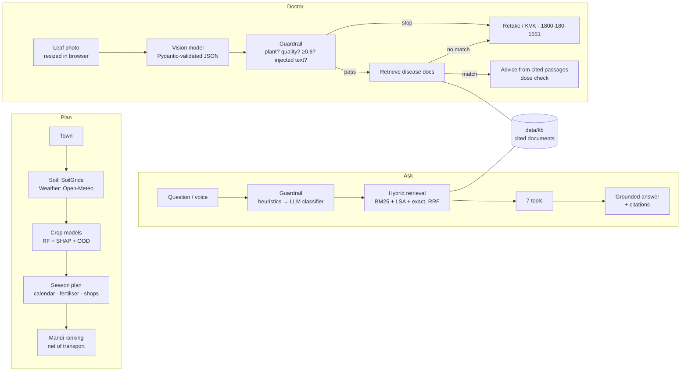

# CropWise

**An AI farming assistant for India's small farmers: the right crop for the soil, fertiliser in
bags, the best mandi after transport, a photo-based Crop Doctor, and a grounded assistant in six
languages — with its accuracy measured in public.**

**Live: https://cropwise-six.vercel.app** · [The problem](https://cropwise-six.vercel.app/impact) ·
[Crop Doctor](https://cropwise-six.vercel.app/doctor) · [KrishiMitra](https://cropwise-six.vercel.app/assistant) ·
[Measured results](https://cropwise-six.vercel.app/eval) · [API docs](https://cropwise-six.vercel.app/docs)


<sub>Live site on a phone, 17 Oct 2026, photographed before the AI key was added — so answers are labelled demo/MOCK.
Leaf photo from the PlantVillage dataset (Mohanty et al., 2016), CC BY-SA 3.0. Animated version:
[docs/demo.gif](docs/demo.gif).</sub>

## The problem

About **86% of India's farm holdings are small or marginal** and the average holding is **1.08 ha**
([PIB](https://www.pib.gov.in/PressReleseDetailm.aspx?PRID=1906888), [PIB 2026](https://www.pib.gov.in/PressReleasePage.aspx?PRID=2246182)).
On a farm that size, the wrong crop, a guessed fertiliser dose (India's N:P:K use was 8.2:3.2:1
against a recommended 4:2:1 — [NITI-hosted EPW paper](https://niti.gov.in/sites/default/files/2023-02/4_EPW_Article_Fertiliser_Use_and_Imbalance_in_India.pdf))
or a sale at the nearest mandi instead of the best one is a large share of the year's income —
and advice is often not in the farmer's language (Hindi, the largest, is the mother tongue of
43.6% of Indians — [Census 2011](https://cdn.downtoearth.org.in/library/0.58521300_1530794876_census-of-india-2011.pdf)).
Sources and a calculator: [/impact](https://cropwise-six.vercel.app/impact).

## What it does

| | |
|---|---|
| **Crop plan** | Town → soil (ISRIC SoilGrids) + weather (Open-Meteo) → three crops with SHAP reasons → sowing window, fertiliser in bags of urea/DAP/MOP, nearby shops (OpenStreetMap), mandis ranked by **net price after transport**, profit per acre |
| **📷 Crop Doctor** | Photo of a sick leaf → likely condition, confidence, and advice **only from cited sources**. Not a plant, blurry or under 60% confidence → no treatment, an honest "ask an expert" and the Kisan Call Centre. Diseases outside its 10 are meant to be escalated too — in testing that failed for grape black rot, and the result is published |
| **💬 KrishiMitra** | Hybrid-RAG assistant with 7 tools over the app's own services, citations on every answer, a two-layer prompt-injection guardrail, voice in and 🔊 read-aloud out, six languages |
| **📊 /eval** | Retrieval, guardrail and Crop Doctor metrics regenerated by `make eval`, shown in the app |

## Architecture



## Measured results

Real numbers from `make test`, `make eval` and `make train`; nothing here is estimated.

| What | Result | Where |
|---|---|---|
| Retrieval Hit@5 (hybrid) | **1.00** on 30 hand-labelled questions | [docs/EVAL.md](docs/EVAL.md) |
| Retrieval MRR (hybrid) | **0.94** | [docs/EVAL.md](docs/EVAL.md) |
| Prompt-injection attacks blocked | **5/5** | [docs/EVAL.md](docs/EVAL.md) |
| Real questions wrongly blocked | **0/30** | [docs/EVAL.md](docs/EVAL.md) |
| Crop model accuracy, town estimate / with soil test | **96.95% / 99.59%** (stratified 5-fold CV) | [docs/MODEL_CARD.md](docs/MODEL_CARD.md) |
| KrishiMitra answers faithful to sources / correctly cited (LLM judge, 10 questions × 3 runs) | **97% / 100%** — first run was 60%, see why | [docs/EVAL.md](docs/EVAL.md) |
| Crop Doctor top-1 accuracy (13 labelled leaves) | **92%** (12/13) | [docs/EVAL.md](docs/EVAL.md) |
| Crop Doctor: non-plant photos refused / photo injections resisted | **5/5 / 3/3** | [docs/EVAL.md](docs/EVAL.md) |
| Crop Doctor: disease it does not cover, escalated | **0/2** — known failure, documented | [docs/EVAL.md](docs/EVAL.md) |
| Crop Doctor cost and time per check | **$0.0002, ~2.6 s** | [docs/EVAL.md](docs/EVAL.md) |
| Automated checks | **174**, all passing (`make test`) | [tests/](tests/) |

## Engineering decisions worth reading

- **Found and removed a data leak.** Two regressors inferred phosphorus and potassium from the classifier's own inputs, inflating accuracy to 0.995. Split into an honest *field* model and a *lab* model that uses a real soil test.
- **Found a fabrication in production.** SoilGrids publishes nothing under built-up land and the app was substituting hard-coded averages as measurements; replaced with a sampling ring that reports how far away the real reading came from.
- **Net price, not headline price.** Mandis are ranked by modal price minus transport, so a far-away high price can lose to a nearer market.
- **Two-layer guardrail.** Cheap weighted heuristics on every message; an LLM classifier only on the uncertain band. Raised from 3/5 to 5/5 attacks blocked by adding narrow patterns, not by lowering the threshold — false positives stayed at 0.
- **Refuse rather than guess.** The assistant refuses when retrieval relevance is low; Crop Doctor refuses on non-plants, poor photos, low confidence or no knowledge-base match, and throws away any generated dose that is not written in a cited passage.
- **Mock mode everywhere.** With no API keys the whole app still runs, and every placeholder (prices, model answers, Crop Doctor's demo) is labelled as such, so tests need no secrets.

More in [docs/DECISIONS.md](docs/DECISIONS.md) and [docs/INTERVIEW_NOTES.md](docs/INTERVIEW_NOTES.md).

## Limits

- A working prototype: **not field-tested with farmers**, no user numbers.
- The crop model is trained on a public 2,200-row Kaggle teaching dataset, not Indian field trials.
- SoilGrids is a ~250 m regional estimate at 0–5 cm, not your field; a Soil Health Card is better.
- Mandi prices are labelled placeholders until a `DATA_GOV_IN_API_KEY` is configured.
- Crop Doctor covers only the 10 diseases in `data/kb/disease_*.md`. It is meant to escalate everything else, but in testing it mistook grape black rot for downy mildew (the advice it then gives names no spray and points to a KVK). Test photos are clean lab images; field photos will be harder.

## Roadmap

1. React front end and an installable PWA
2. Satellite crop-health (NDVI) for the farmer's own plot
3. WhatsApp and phone (IVR) access for farmers without smartphones
4. A multi-agent season planner that re-plans as weather and prices change

## Run locally

```bash
make install             # python3.11 venv + dependencies
cp .env.example .env     # set SECRET_KEY; API keys are optional
make run                 # http://127.0.0.1:8000 — API docs at /docs
make test                # all checks; the AI paths need no keys or network
make eval                # retrieval + guardrail metrics -> docs/EVAL.md and /eval
make eval-doctor         # Crop Doctor metrics (needs OPENROUTER_API_KEY)
```

### Configuration

| Variable | Needed | Meaning |
|---|---|---|
| `SECRET_KEY` | yes in production | Signs the visitor cookie |
| `OPENROUTER_API_KEY` | no | Language and vision models; without it answers are extractive and Crop Doctor runs a labelled demo |
| `LLM_MODEL` / `VISION_MODEL` | no | OpenRouter model ids (default `google/gemini-2.5-flash-lite`) |
| `DATA_GOV_IN_API_KEY` | no | Real Agmarknet mandi prices; without it prices are labelled MOCK |
| `TRANSPORT_RATE_PER_QUINTAL_KM` | no | Transport cost used in the mandi ranking (default ₹2.5) |
| `DATABASE_URL` | no | Postgres URL; defaults to SQLite |
| `CORS_ORIGINS` | no | Comma-separated allow-list for browser calls |

### API

Everything the pages do is available as JSON, documented at [/docs](https://cropwise-six.vercel.app/docs):
`/api/v1/predict`, `/plan/{crop}`, `/stores`, `/mandi`, `/best-market`, `/profit`, `/season`,
`/impact/mandi-gain`, `/assistant` (+ `/stream`), `/doctor` and `/doctor/conditions`.

Privacy: no sign-up; a random cookie keeps one visitor's history separate. Crop Doctor photos are
processed in memory and never stored or logged.
